(tandem-mobi)=
# Tandem Mobi

These instructions are for configuring the **Tandem Mobi** insulin pump with **AAPS**.

```{warning}
The Tandem Mobi driver is in **beta testing** and is not yet part of an official **AAPS** release. Not all functionality is fully implemented or tested. Read this whole page before you start, and report problems as described in [Where to get help](#tandem-mobi-where-to-get-help).
```

```{contents} Table of contents
:depth: 1
:local: true
```

(tandem-mobi-capabilities)=
## Pump capabilities with AAPS

* Temporary basal rates (TBR): set, read and cancel. This enables looping with oref0.
* Boluses and SMBs. This enables looping with oref1.
* Basal profile: read and set (see [Mobi-specific limitations](#tandem-mobi-limitations) for the 16-segment limit).
* Pump settings: max bolus, max basal and quick bolus are read and set by **AAPS**, and Control-IQ is turned off.
* Battery and insulin level.
* Pump notifications (alerts, alarms and malfunctions): shown in **AAPS** and confirmed from **AAPS**.
* Qualifying events and pump history: read from the pump and shown in **AAPS**.
* Cartridge change, tubing fill, cannula fill, and stopping and starting insulin, all from **AAPS**.
* Pairing directly from **AAPS**, or through a shared connection with ControlX2.
* Time zone and daylight saving time changes (not tested yet).

% VERIFY: confirm the last two bullets of the old feature list (pump history; cartridge and
% cannula) against the current driver before publishing.

(tandem-mobi-hardware-software-requirements)=
## Hardware and software requirements

* **A Tandem Mobi pump.**
* **A Qi-compatible wireless charger.** You need one to power on and to pair the pump. Any Qi charger works, not only the Tandem charging pad. MagSafe chargers also work, but keep the cartridge area of the pump away from the magnets to avoid damaging the piston.
* **AAPS built from the `andy_tandem_dev4` branch** of [Andy's AndroidAPS repository](https://github.com/andyrozman/AndroidAPS) and installed, see the [Testing guide](../testing/testing-guide.md).
* **A compatible Android phone** with a Bluetooth Low Energy (BLE) connection.
* **[ControlX2](https://github.com/jwoglom/controlX2)** (recommended), installed on the same phone. ControlX2 is a small open-source Android app by @jwoglom, one of the co-authors of this integration. It can monitor the pump, deliver boluses and temp basals, and change (nearly) all pump settings, including Mobi-specific commands such as Change Cartridge and Fill Cannula. It is your fallback if something goes wrong with **AAPS**.

(tandem-mobi-before-you-begin)=
## Before you begin

### SAFETY FIRST

The Mobi has no screen, so if something goes wrong you have limited options to fix the pump from within **AAPS**. Do not start without:
* a **wireless charger** within reach, in case you need to re-pair, switch phones, or switch from **AAPS** to the official Mobi app, and
* **ControlX2** or the official **Tandem Mobi** app (iPhone; an Android version was expected by the end of Q1 2026) to recover the pump if **AAPS** can't.

### Only one app can be connected to the pump at a time

Installing ControlX2 doesn't mean running it alongside **AAPS**: running both confuses the pump and causes disconnections. If something goes wrong, force-stop **AAPS**, then start ControlX2 to troubleshoot the pump.

### AAPS stays connected to the Mobi 24/7

Once the pump is set up, **AAPS** never disconnects from it. This mirrors how the official app works, and the Mobi is designed for this with Bluetooth Low Energy. See [Events](#tandem-mobi-events) for why the connection matters.

### Control-IQ is turned off while AAPS controls the pump

Every time **AAPS** connects, the driver checks whether Control-IQ is enabled and turns it off as a safety measure. **Control-IQ and AAPS must never run at the same time.** To go back to Control-IQ, disable **AAPS** and turn Control-IQ back on in ControlX2.

### The pump can't be made silent

The Mobi beeps or vibrates every time **AAPS** sends a temp basal or a bolus. Read [Mobi-specific limitations](#tandem-mobi-limitations) before you decide to use the driver.

(tandem-mobi-power-on)=
### Powering on the Mobi

If you have a brand-new Mobi, or need to wake it from "deep sleep" mode:

1. Plug in the Mobi charging pad, or any other Qi charging pad.
2. Place the Mobi on the charging pad.
3. If no lights appear, hold down the pump button for about 15 seconds until the lights begin to flash.
4. When the pump has turned on, it flashes its red lights and beeps.

```{raw} html
<div class="video">
  <iframe src="https://www.youtube.com/embed/nc2VPbao0fs" title="Powering on the Tandem Mobi"
    allow="accelerometer; autoplay; clipboard-write; encrypted-media; gyroscope; picture-in-picture; web-share"
    referrerpolicy="strict-origin-when-cross-origin" allowfullscreen></iframe>
</div>
```

(tandem-mobi-setup)=
## Setup

Select **Tandem Mobi** as your pump: in the **Setup Wizard** at the **Pump** step on a new installation, or in **Configuration** > **Pump** on an existing one. Then force-stop and restart **AAPS**, or restart your phone. Make sure the pump is [powered on](#tandem-mobi-power-on).

Then connect **AAPS** to the pump in one of two ways:

- [A) Shared connection with ControlX2](#tandem-mobi-pair-controlx2): pair with ControlX2 first, then give the pairing data to **AAPS**. This is currently the more reliable option.
- [B) Pairing with AAPS only](#tandem-mobi-pair-aaps): pair from the **AAPS** pairing wizard.

Both options need the pump in [pairing mode](#tandem-mobi-pairing-mode).

(tandem-mobi-pair-controlx2)=
### A) Shared connection with ControlX2

1. Install the latest ControlX2 release from the [ControlX2 releases page](https://github.com/jwoglom/controlX2/releases) ({{ controlx2_version }} at the time of writing) on the **same phone** you use for **AAPS**.
2. Launch ControlX2 and grant the permissions it asks for, so it can scan for pumps.
3. Follow the ControlX2 pairing wizard, and put the pump in [pairing mode](#tandem-mobi-pairing-mode) when asked.
4. Once ControlX2 is communicating with the pump, open **Settings** > **Debug** > **View Pump State**. This shows a JSON string with all the connection data. Tap **Save to Clipboard**.
5. **Force-stop ControlX2**, then start **AAPS**.
6. Open the [Mobi settings](#tandem-mobi-settings) and turn on **Use Shared Connection**. This shows **Shared Connection Data**.
7. Tap **Shared Connection Data**, paste the JSON string from ControlX2, and leave the settings screen.

**AAPS** should now connect to your pump. If it doesn't straight away, force-stop **AAPS** and start it again.

(tandem-mobi-pair-aaps)=
### B) Pairing with AAPS only

```{note}
Pairing in **AAPS** is a newer addition to the Mobi driver, and is not yet as reliable as pairing through ControlX2.
```

1. Open the [Pump Screen](#tandem-mobi-pump-screen) and tap **Pump Pair**. If the button isn't there, open the [Mobi settings](#tandem-mobi-settings) and turn off **Use Shared Connection** and **Hide Pump Pair Button in Overview**.
2. Follow the wizard, and put the pump in [pairing mode](#tandem-mobi-pairing-mode) when asked. If the pump isn't found, see [If the pump can't be found](#tandem-mobi-pump-not-found).

% VERIFY: the steps above are inferred from the "Hide Pump Pair Button in Overview" setting.
% Confirm the button name and that it opens the pairing wizard.
% SCREENSHOT: add the pump screen with Pump Pair and each wizard step (SCREENSHOTS.md: aaps-wizard).

```{raw} html
<div class="video">
  <iframe src="https://www.youtube.com/embed/wsXEqxq8lGg" title="Pairing the Mobi with AAPS"
    allow="accelerometer; autoplay; clipboard-write; encrypted-media; gyroscope; picture-in-picture; web-share"
    referrerpolicy="strict-origin-when-cross-origin" allowfullscreen></iframe>
</div>
```

(tandem-mobi-pairing-mode)=
### Putting the Mobi in pairing mode

Pairing is a little temperamental, because it isn't designed to be done often, so it may take several tries.

1. Place the pump on the charging pad and wait for the white lights to pulse, which shows the pump is charging. If any alerts are active you will see blinking red lights; wait until they stop.
2. Pick the pump up off the charger and wait about 2–3 seconds.
3. Press the pump button twice. You may need to do this slowly and deliberately: press for a quarter of a second, release, wait half a second, then press again.
4. When pairing mode starts, the pump vibrates and beeps twice.

The video below shows an unsuccessful attempt where the pump doesn't beep or vibrate (first try), followed by a successful attempt where it beeps and vibrates (second try).

```{raw} html
<div class="video">
  <iframe src="https://www.youtube.com/embed/u6wuikEiY8Y" title="Putting the Mobi into pairing mode"
    allow="accelerometer; autoplay; clipboard-write; encrypted-media; gyroscope; picture-in-picture; web-share"
    referrerpolicy="strict-origin-when-cross-origin" allowfullscreen></iframe>
</div>
```

(tandem-mobi-pump-not-found)=
### If the pump can't be found

You may get stuck on a screen like this one in ControlX2, with no pumps found:

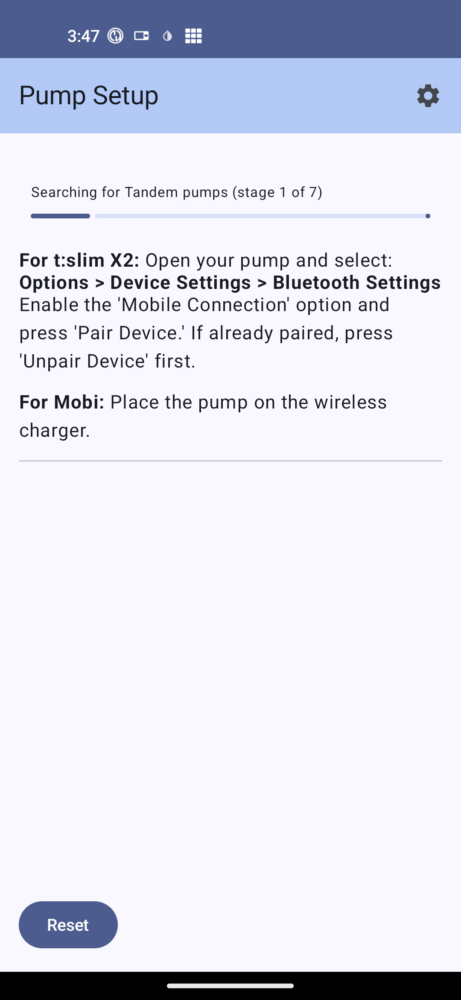

If this happens and you are sure the Mobi is in pairing mode, open the Android **App info** screen for ControlX2 (from recent apps, or by long-pressing its icon) and open **Permissions**. Every permission should be listed under **Allowed**. The same applies to **AAPS** when pairing with option B.

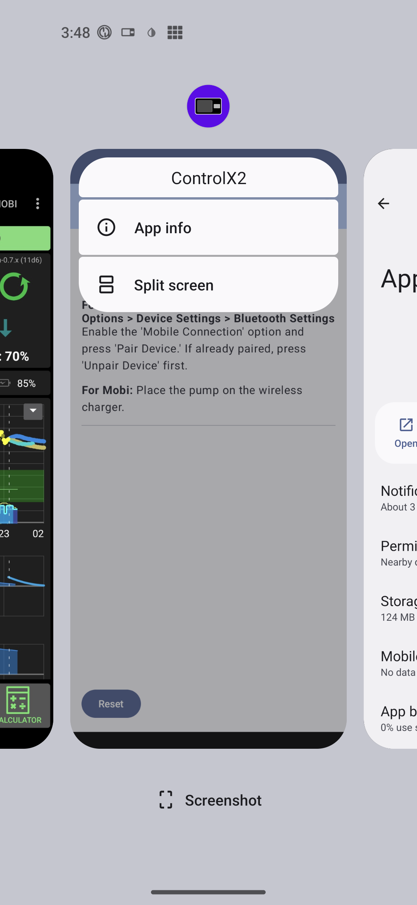

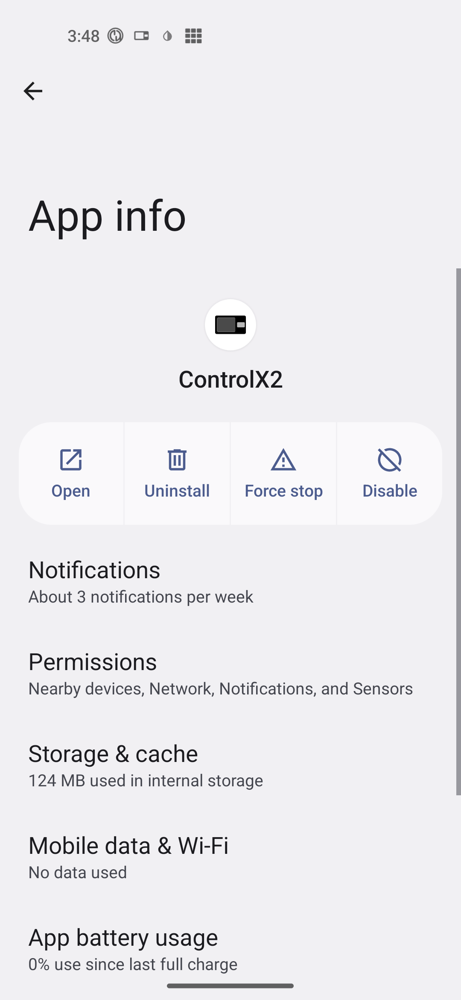

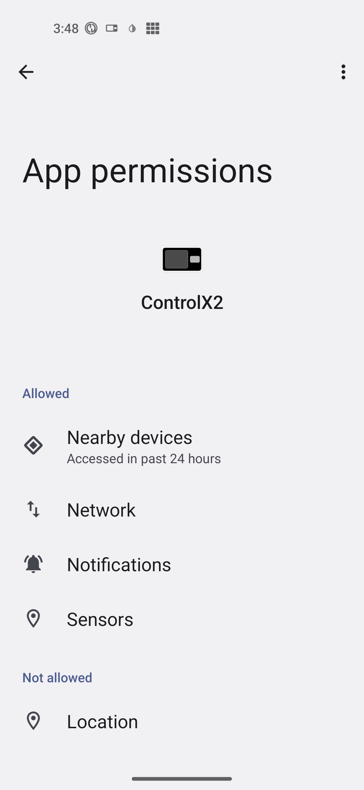

% SCREENSHOT: controlx2_appinfo_3.png shows Location under "Not allowed". Retake with every
% permission allowed (SCREENSHOTS.md: cx2-appinfo-3).

Some phones need the **Location** permission before they can find all Bluetooth devices. If you can't find your pump, tap **Location** and allow it either "while using the app" or "all the time".

(tandem-mobi-settings)=
### Mobi settings

Tap the gear icon in the top-right corner of the [Pump Screen](#tandem-mobi-pump-screen). This opens **Mobi Pump Settings**:

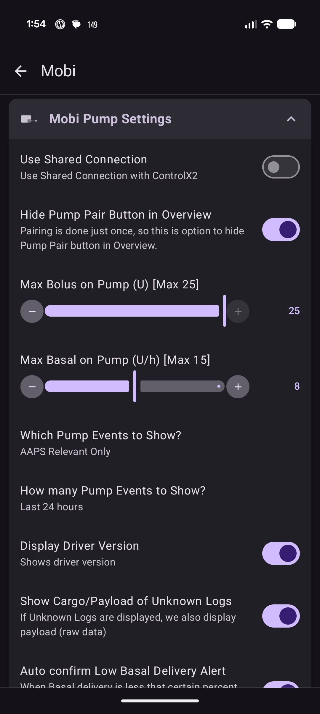

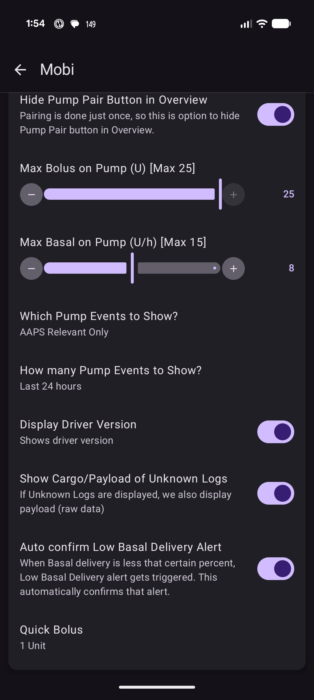

#### Use Shared Connection

Whether **AAPS** uses pairing data from ControlX2. When enabled, fill in **Shared Connection Data**. When disabled, pair from **AAPS** with the **Pump Pair** button on the Pump Screen. See [A) Shared connection with ControlX2](#tandem-mobi-pair-controlx2).

#### Hide Pump Pair Button in Overview

Pairing is only done once, so after the pump is paired you can hide the **Pump Pair** button on the Pump Screen.

#### Max Bolus on Pump (U)

The largest bolus that can be sent in a single request. This is not an hourly limit. Valid values are 1–25 U. If you need a bigger dose, give two boluses, waiting for the first to finish before starting the second.

#### Max Basal on Pump (U/h)

The highest basal rate the pump can be set to deliver. Valid values are 1–15 U/h. You can use the maximum, but to limit it, take your highest hourly basal rate and multiply it by 2.5. 250% is the highest temp basal the Mobi supports: with a base rate of 1 U/h, the pump will not accept temp rates above 2.5 U/h.

Set both limits with the slider or the **−** and **+** buttons.

#### Which Pump Events to Show?

Show all events, or only those relevant to **AAPS**. Some events reported by the pump matter very little to **AAPS**.

#### How many Pump Events to Show?

Limit the number of pump events shown: the last 15 items, or the last 3, 6, 12 or 24 hours.

#### Display Driver Version

Shows the driver version on the [Pump Screen](#tandem-mobi-pump-screen). Include this version whenever you report a bug: it helps find the problem and check whether it has already been fixed.

#### Show Cargo/Payload of Unknown Logs

When unknown history logs are shown, also show their raw payload (as hexadecimal).

#### Auto confirm Low Basal Delivery Alert

When the delivered basal drops below a certain percentage, the pump raises a **Low Basal Delivery** alert. When this setting is on, **AAPS** confirms those alerts automatically.

% VERIFY: the old text gave the threshold as "less than 50% ??". Confirm the actual threshold.

#### Quick Bolus

The pump button can deliver quick boluses. This sets the amount added per button press: 0.5 U, 1 U, 2 U or 5 U, or enough to cover 2 g, 5 g, 10 g or 15 g of carbs.

For example, with 0.5 U: hold the pump button until it vibrates or beeps, then press it four times for a 2 U bolus. The pump confirms the amount with the same number of beeps or vibrations; hold the button again to confirm the bolus.

### Insert a cartridge and start insulin

With the pump connected and set up, prepare it for use from the [Actions](#tandem-mobi-actions) screen:

1. [Change the cartridge](#tandem-mobi-change-cartridge).
2. [Fill the tubing](#tandem-mobi-fill-tubing).
3. Connect the infusion site and [fill the cannula](#tandem-mobi-fill-cannula).
4. [Start insulin](#tandem-mobi-stop-resume).

(tandem-mobi-architecture)=
## Mobi Specific Architecture

How the Mobi and the driver work together, and what that means for you.

(tandem-mobi-limitations)=
### Mobi-specific limitations

**The pump can't be made silent.** Depending on its settings, the Mobi beeps (at low, medium or high volume) or vibrates every time **AAPS** sends a temp basal or a bolus. There is currently no known workaround.

Control-IQ, Tandem's own closed loop, runs on the pump, so its adjustments make no sound. **AAPS** (and future Loop or Trio integrations) send commands from the phone, so the pump treats every temp basal and bolus as if a person made it. Only a Tandem firmware update with a "silent mode", or quieter (or no) volume and vibration, can change this. In the meantime, use ControlX2 or the official Mobi app to change the **General** sound setting, which controls the sound or vibration used for temp basals and boluses.

**The basal profile can have at most 16 time segments.** Model your **AAPS** basal profile accordingly.

**Bolus progress is an estimate.** See [Bolus progress](#tandem-mobi-bolus-progress).

**Some malfunction codes shown in AAPS are not real malfunctions.** See [Malfunction codes](#tandem-mobi-malfunction-codes).

(tandem-mobi-startup-sequence)=
### Startup sequence

Every time **AAPS** starts and the driver connects to the pump, it runs a sequence of commands to read the initial data and check that the pump is working and what state it is in. This can take up to 2 minutes, depending on how fast your phone is, how good the Bluetooth connection is, and whether this is one of the first times you run the driver.

1. Check the pump time and correct it if needed.
2. Read any active alarms or alerts.
3. Read the pump status (running or suspended).
4. Read the [pump history](#tandem-mobi-history-reading).
5. Read the remaining insulin.
6. Read the battery level.
7. Read all settings and check they are set correctly; any that aren't are updated on the pump, and Control-IQ is turned off.
8. Read the last bolus.
9. Read the basal profile.

The buttons on the Pump Screen are disabled while the startup sequence runs.

(tandem-mobi-notifications-explained)=
### Pump notifications

Because the pump has no screen, it signals notifications with beeps, vibrations and the lights next to the button. It also sends the alarm or alert over Bluetooth to **AAPS**. The driver reads notifications every 5 minutes, and usually also as soon as the pump sends an [event](#tandem-mobi-events) about them. When there are any, the **NOTIFICATIONS** label on the [Pump Screen](#tandem-mobi-pump-screen) is highlighted, and you confirm them in the [Notifications](#tandem-mobi-notifications) view.

"Notifications" covers four types of message. The links show the values for each type in the PumpX2 reference:

- **[Pump alerts](https://jwoglom.github.io/pumpX2/javadoc/messages/com/jwoglom/pumpx2/pump/messages/response/currentStatus/AlertStatusResponse.AlertResponseType.html)** (least severe).
- **[CGM alerts](https://jwoglom.github.io/pumpX2/javadoc/messages/com/jwoglom/pumpx2/pump/messages/response/currentStatus/CGMAlertStatusResponse.CGMAlert.html):** only relevant when the Mobi itself is connected to a CGM, which **AAPS** doesn't currently support.
- **[Alarms](https://jwoglom.github.io/pumpX2/javadoc/messages/com/jwoglom/pumpx2/pump/messages/response/currentStatus/AlarmStatusResponse.AlarmResponseType.html).**
- **Malfunctions** (most severe). Some correspond directly to an alarm, but most are undocumented. The most severe malfunctions mean the pump must be reset or replaced by Tandem (for example, a hardware failure). See [Malfunction codes](#tandem-mobi-malfunction-codes).

Most notifications (alerts) are for information, but alarms and some other notifications block pump commands. For example, while an alarm is unconfirmed you can't start or stop insulin or do any cartridge or cannula actions, so confirming notifications is an important step. These alarms aren't only for problems: some just tell you that insulin delivery has been suspended for a long time.

Most notifications also cause an event to be created. For the most part, you can treat notifications, events, alarms and alerts as the same thing.

(tandem-mobi-events)=
### Events

When something happens on the pump, it sends an event. An event tells **AAPS** to ask the pump for more information, which may need to be shown to you. Events give real-time warnings and information from the pump, and are the main reason **AAPS** stays connected to the pump 24/7. You can see them in the [Events](#tandem-mobi-events-view) view.

The driver doesn't rely on events alone: it still polls the pump on a [schedule](#tandem-mobi-refresh-schedule) so nothing is missed.

% VERIFY: the old text said event support "is not fully working yet in library".
% Confirm whether that is still true.

(tandem-mobi-refresh-schedule)=
### Data refresh schedule

| Data | Refreshed |
| --- | --- |
| Pump status, alerts, alarms, history | Every 5 minutes |
| Remaining insulin | Every hour above 50%, every 30 minutes above 20%, every 15 minutes below 20% |
| Battery level | Every hour above 30%, every 30 minutes above 20%, every 15 minutes below 20% |

When events from the pump work correctly, this data is also read whenever the pump reports a change, for example a drop in insulin or battery level.

(tandem-mobi-history-reading)=
### Pump history

Pump history is read every 5 minutes, together with the pump status check.

- History is read from newest to oldest, in up to 5 chunks of 200 records each. Once records are older than 1.5 months, no more history is read.
- For roughly the first day, many records are read (up to 1000 at startup and at each status check); after that, only new ones.
- Records older than 1.5 months are removed from the database so it doesn't grow needlessly.

History is not fully parsed: **AAPS** shows the fields the PumpX2 library recognizes, with some parsing of a few known fields. History is for information and is not used by the driver, but it is useful for testing: it is a durable log, kept by the pump, of the operations performed, which you can check against the actions **AAPS** logged. You can see it in the [Pump History](#tandem-mobi-pump-history) view.

(tandem-mobi-bolus-progress)=
### Bolus progress

The Mobi driver supports both standard boluses and SMBs. Bolus progress is only an estimate: the Mobi doesn't report how much of a bolus has been delivered, so the driver estimates it from how long the bolus has been running. The bolus may finish before the progress bar reaches the end, or the bar may reach the end while the bolus is still delivering. PumpX2 provides some ways to detect when a bolus has finished, but **AAPS** doesn't fully use them yet.

While a bolus runs, a progress dialog shows the amount being delivered and a **Stop** button, and the Pump Screen shows it in the **Active Bolus** field.

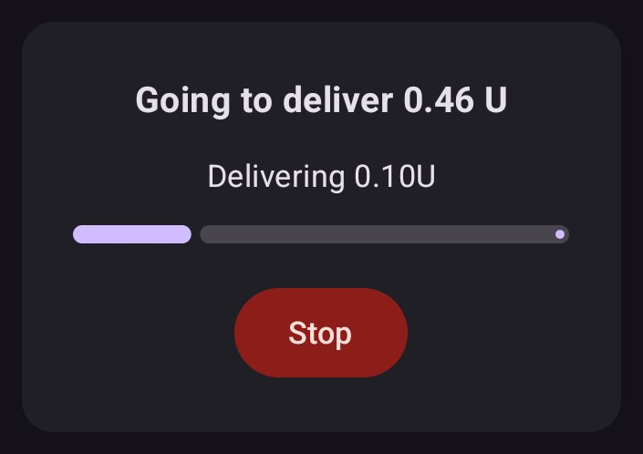

(tandem-mobi-pump-screen)=
## Pump Screen

The Pump Screen shows the state of the pump and gives access to everything you do with it. The gear icon in the top-right corner opens the [Mobi settings](#tandem-mobi-settings).

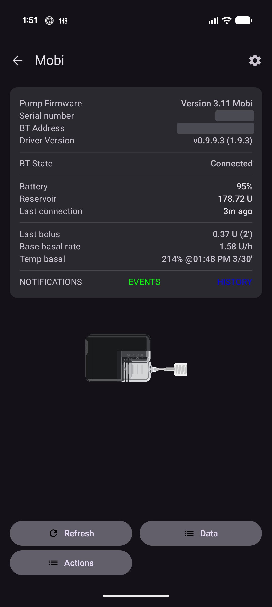

While a command is running, a card at the top of the screen shows it, and **BT State** shows what the driver is doing. This is the screen while an SMB is being delivered:

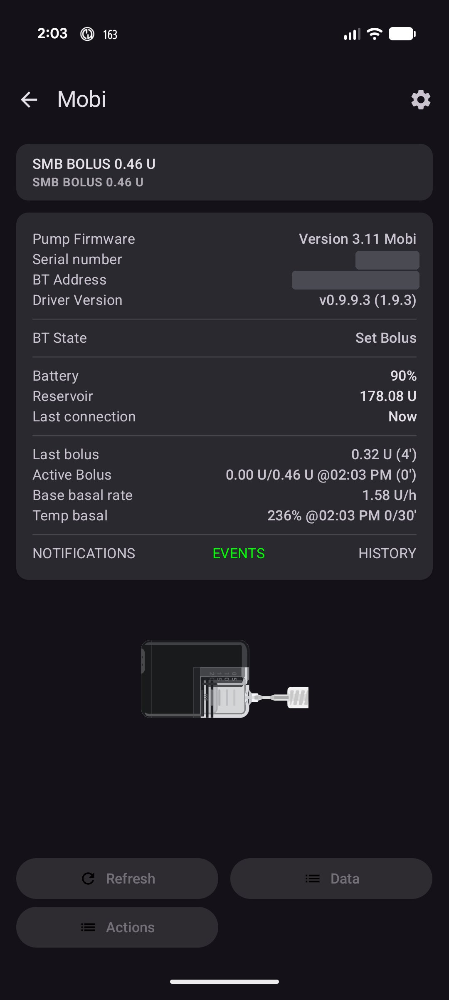

### Fields

- **Pump Firmware:** The firmware version of the pump.
- **Serial number:** The serial number of the pump.
- **BT Address:** The Bluetooth address of the pump.
- **Driver Version:** The version of the **AAPS** Mobi driver. Shown only when [Display Driver Version](#tandem-mobi-settings) is on.
- **BT State:** **Connected** when the pump is connected and idle. While a command is running, it shows what the driver is doing, for example **Set Bolus**.
- **Battery:** The pump battery level.
- **Reservoir:** The insulin left in the cartridge.
- **Last connection:** When the last command was processed.
- **Last bolus:** The amount of the last bolus and how long ago it was given.
- **Active Bolus:** Shown only while a bolus is being delivered: the amount delivered so far against the amount requested, and when it started.
- **Base basal rate:** The basal rate for the current time in your **Profile**.
- **Temp basal:** The temp basal that is running, with its rate, start time and duration. Shown only while a temp basal is running.
- **Command card:** Shown at the top of the screen only while a command is running, for example **SMB BOLUS 0.46 U**.
- **Driver errors:** Shown only when there is a problem, mostly a configuration problem or a lost connection to the pump. If you lose the connection, force-stop and restart **AAPS**.
- **NOTIFICATIONS**, **EVENTS** and **HISTORY:** Show whether there is anything new in [Data](#tandem-mobi-pump-data). A label is shown in color when there are new items (red for notifications, green for events, blue for history), and in the normal theme color when there is nothing new. Tap a label to open that view.

% VERIFY: the old text said the queue of pending commands is also shown. Confirm whether the
% command card lists queued commands.
% VERIFY: the old text said auto-reconnect would be added in Phase 3. Confirm the current
% reconnect behaviour and update "Driver errors" above.

```{important}
The **NOTIFICATIONS** label matters most when you set up a pump for the first time or change the cartridge. The Mobi rejects **Change Cartridge** and **Fill Tubing** until you have confirmed the notifications about insulin delivery being suspended.
```

### Buttons

- **Refresh:** Reads all data from the pump again. This is the same as the [startup sequence](#tandem-mobi-startup-sequence) that runs when **AAPS** starts.
- **Data:** Opens [Data](#tandem-mobi-pump-data): notifications, events and pump history.
- **Actions:** Opens [Actions](#tandem-mobi-actions).
- **Pump Pair:** Starts [pairing with AAPS](#tandem-mobi-pair-aaps). Hidden when **Hide Pump Pair Button in Overview** is on.

The buttons are disabled while the startup sequence is running.

(tandem-mobi-ui)=
## Mobi Specific UI

(tandem-mobi-actions)=
### Actions

Tap **Actions** on the Pump Screen. The card at the top shows the cartridge level and whether insulin delivery is enabled or suspended.

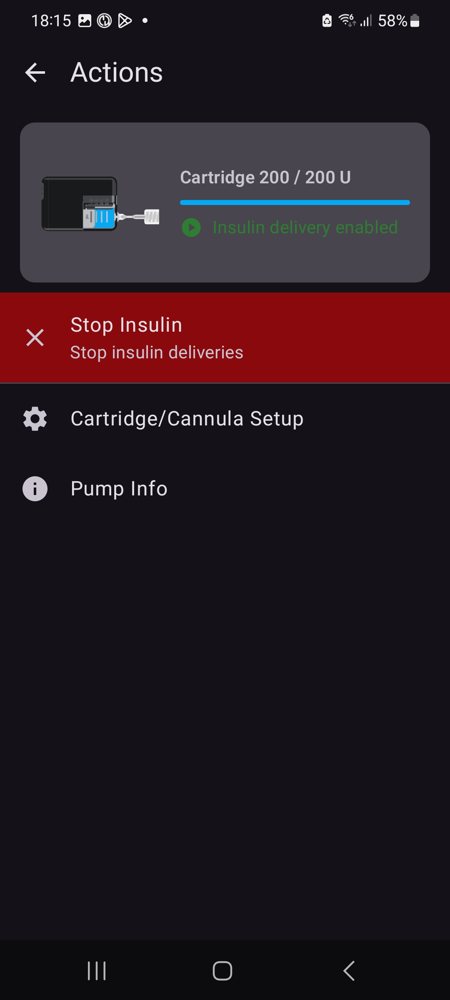

- **Stop Insulin** / **Start Insulin:** See [Stopping and resuming insulin delivery](#tandem-mobi-stop-resume).
- **Stop Temp Rate:** Shown only while a temp basal is running. See [Stopping a temp basal](#tandem-mobi-stop-temp-basal).
- **Cartridge/Cannula Setup:** See [Cartridge and cannula setup](#tandem-mobi-cartridge-setup).
- **Pump Info:** See [Pump Info](#tandem-mobi-pump-info).

```{important}
Before you start or stop insulin, change the cartridge, or fill the tubing or cannula, confirm any active pump [notifications](#tandem-mobi-notifications). The Mobi rejects these commands while an alarm is unconfirmed.
```

(tandem-mobi-stop-resume)=
#### Stopping and resuming insulin delivery

To **stop** insulin delivery, tap **Stop Insulin**, then **Stop insulin** to confirm.

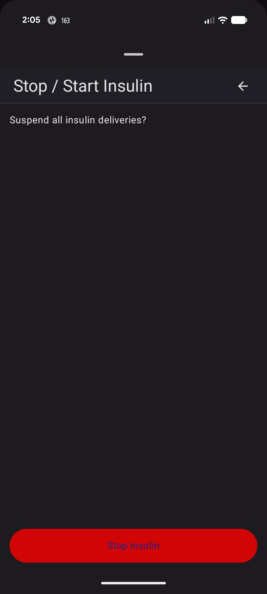

To **resume** insulin delivery, tap **Start Insulin**, then **Resume insulin** to confirm.

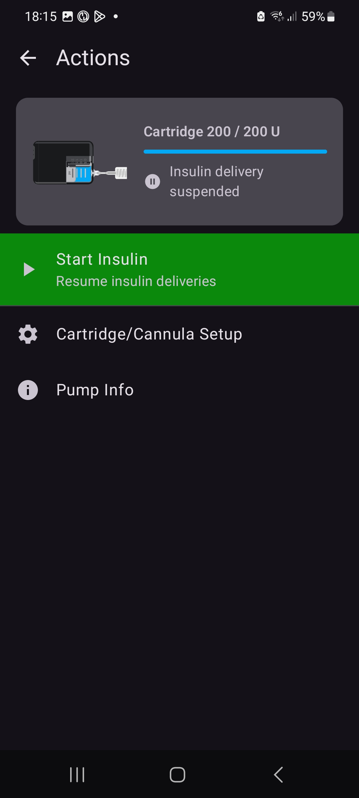

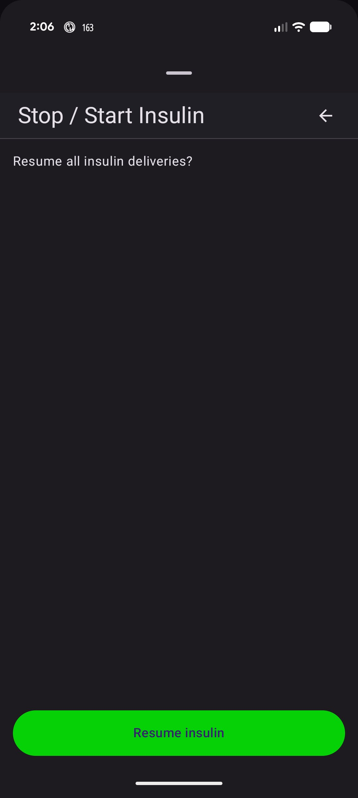

(tandem-mobi-stop-temp-basal)=
#### Stopping a temp basal

You can't stop insulin while a temp basal is running. When one is running, the Actions screen shows an extra **Stop Temp Rate** option with the active rate and time left.

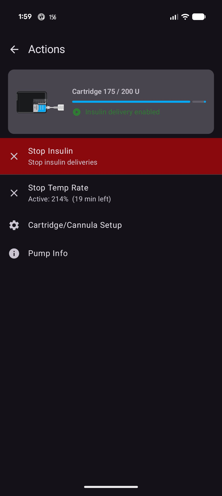

1. Tap **Stop Temp Rate**.
2. The dialog shows the rate, duration and start time of the temp basal. Tap **Stop Temp Rate** to cancel it, or **Cancel** to keep it running.

   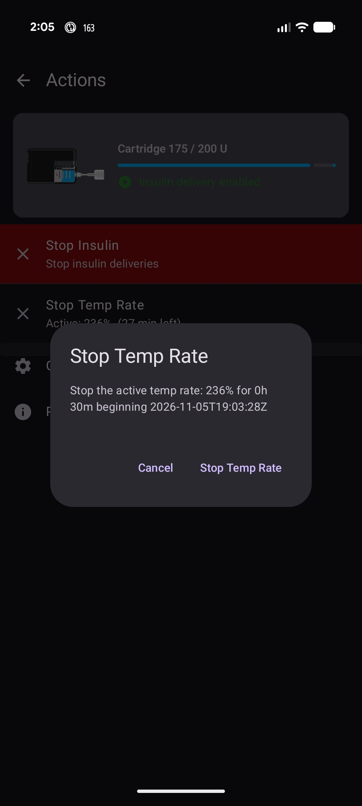

3. Tap **Stop Insulin**.

% VERIFY: Stop Insulin is shown as usable while a temp basal runs. Confirm it is still refused.

(tandem-mobi-cartridge-setup)=
#### Cartridge and cannula setup

Tap **Cartridge/Cannula Setup** on the Actions screen. The check marks show which steps you have completed.

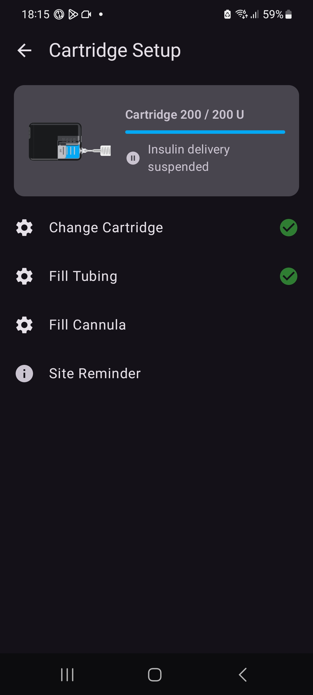

Insulin delivery must be stopped before you change the cartridge or fill the tubing.

(tandem-mobi-change-cartridge)=
##### Change cartridge

1. Tap **Change Cartridge**. Disconnect the pump from your body or infusion site, then tap **Begin Change Cartridge**.

   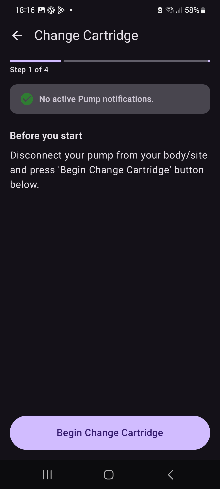

2. The cartridge unlocks. Remove the old cartridge, insert the new one, then tap **Cartridge Inserted**.

   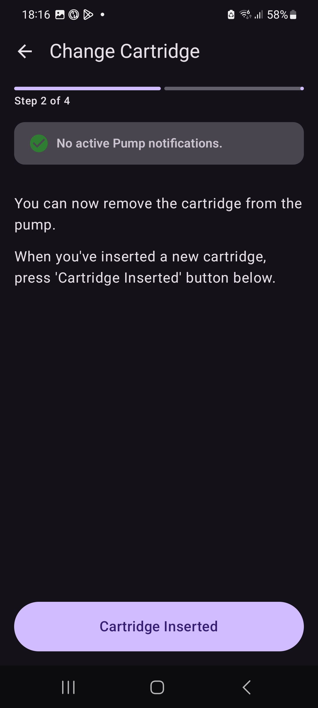

3. Wait while the pump finishes the cartridge change.

   % SCREENSHOT: step 3 is missing (SCREENSHOTS.md: cart-3).

4. When the status shows **Cartridge change complete**, tap **Done**. You can now [fill the tubing](#tandem-mobi-fill-tubing).

   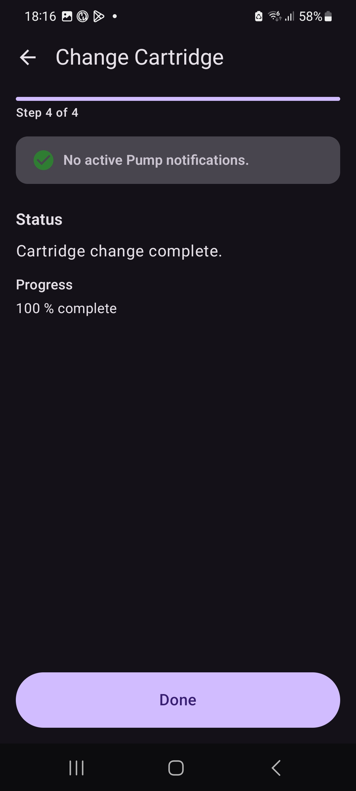

(tandem-mobi-fill-tubing)=
##### Fill tubing

```{warning}
Disconnect the pump from your body or infusion site before filling the tubing.
```

1. Tap **Fill Tubing**, then **Begin Fill Tubing**.

   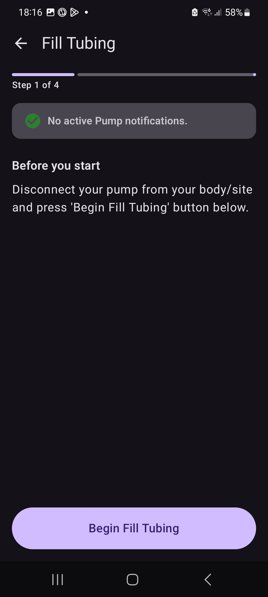

2. Hold down the pump button until insulin comes out of the end of the tubing, then release it.

   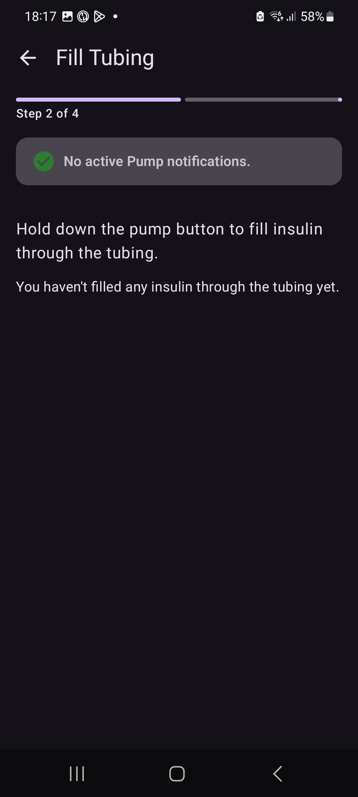

   **AAPS** asks whether you can see insulin at the end of the tubing:
   - **Yes**: tap **Complete Fill**.
   - **No**: hold the pump button again to keep filling.
   - If holding the pump button doesn't move the motor, tap **Restart Fill**.

   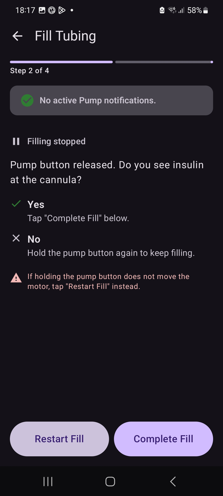

3. The pump finishes the fill, and **AAPS** moves on automatically.

   % SCREENSHOT: step 3 is missing (SCREENSHOTS.md: fill-3).

4. When the status says you can connect the infusion site, tap **Done**. Connect the site and [fill the cannula](#tandem-mobi-fill-cannula).

   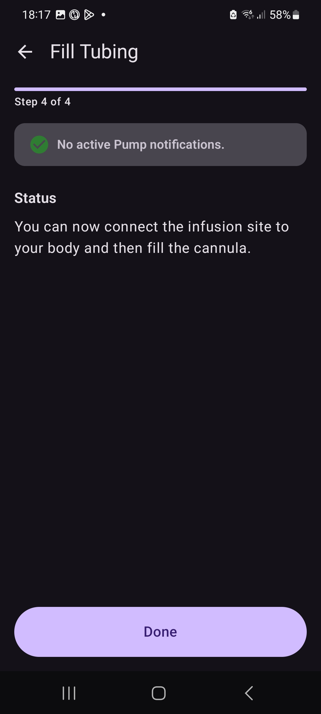

(tandem-mobi-fill-cannula)=
##### Fill cannula

1. Tap **Fill Cannula**.
2. Enter the number of units your cannula needs and tap **Fill Cannula**.

% SCREENSHOT: no screenshot of Fill Cannula yet (SCREENSHOTS.md: cannula-1, cannula-2).

(tandem-mobi-site-reminder)=
##### Site reminder

Site reminders are kept in **AAPS**, not on the pump.

- Choose one of the presets, then tap **Apply Preset** to set the reminder date and time.
- You can also change the date and time by hand, or apply a preset and then adjust it.
- If the date or time is shown in blue, you have unsaved changes: tap **Save**, or they will be lost.

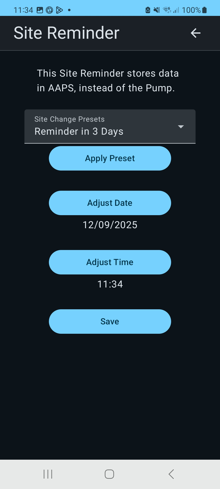

```{admonition} Older screenshot
:class: note
The screenshot above is from an earlier **AAPS** version. In **AAPS** 4 the screen looks different, but the presets and **Save** work the same way.
```

% SCREENSHOT: site_reminder.jpg is pre-Compose UI (SCREENSHOTS.md: site-reminder).

(tandem-mobi-pump-info)=
#### Pump Info

Tap **Pump Info** on the Actions screen to see technical information about the pump: serial number, pump software version, ARM software version, software part number, configuration bits, pump model, and PCBA serial and revision. You may need it if you contact Tandem support about a problem.

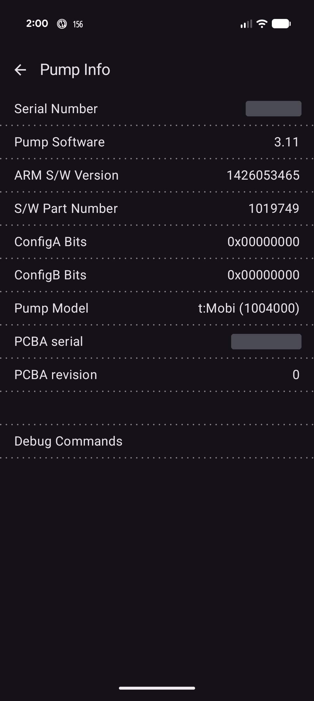

At the bottom of the screen is **Debug Commands**.

% VERIFY: describe what Debug Commands does and who should use it.

```{note}
When contacting Tandem support, don't mention **AAPS** or ControlX2: support staff won't know what they are and may be less helpful. Using **AAPS** should not void your warranty, but Tandem wants you to use their own software.
```

(tandem-mobi-pump-data)=
### Data

Tap **Data** on the Pump Screen, or tap one of the **NOTIFICATIONS**, **EVENTS** or **HISTORY** labels.

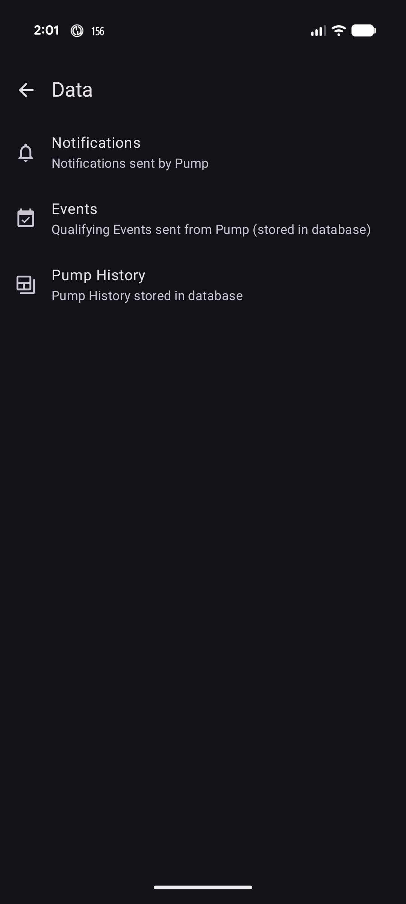

- **[Notifications](#tandem-mobi-notifications):** notifications sent by the pump. You can, and must, confirm them.
- **[Events](#tandem-mobi-events-view):** qualifying events sent by the pump. For information only.
- **[Pump History](#tandem-mobi-pump-history):** history records stored on the pump. For information only.

(tandem-mobi-notifications)=
#### Notifications

This view shows all notifications currently active on the pump. For what the different types mean, see [Pump notifications](#tandem-mobi-notifications-explained).

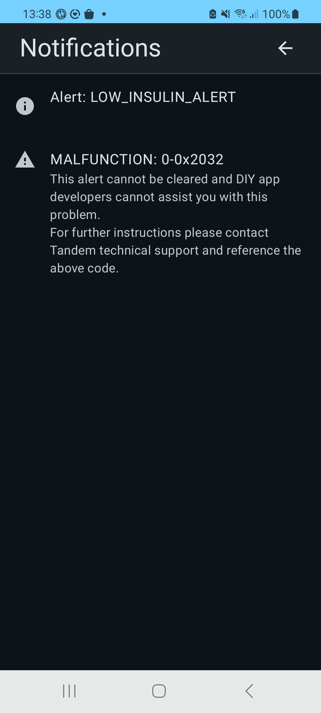

```{admonition} Older screenshot
:class: note
The screenshot above is from an earlier **AAPS** version. In **AAPS** 4 the screen looks different, but confirming notifications works the same way.
```

% SCREENSHOT: data_notifications.jpg is pre-Compose UI (SCREENSHOTS.md: data-notif).

- **Tap a notification to confirm it.** It is dismissed on the pump and disappears from the list, and the pump stops beeping or vibrating about it.
- Most alerts and alarms come with a malfunction. Malfunctions can't be confirmed, but they disappear when the related alert or alarm is confirmed.
- Some malfunctions are filtered out. Filtering for all known malfunctions is being added.

(tandem-mobi-events-view)=
#### Events

Lists the [events](#tandem-mobi-events) sent by the pump, with their date, time and keyword. Which events are shown, and how many, is set by [Which Pump Events to Show? and How many Pump Events to Show?](#tandem-mobi-settings).

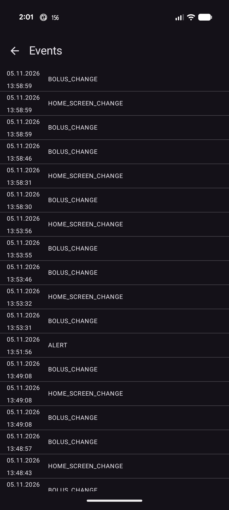

(tandem-mobi-pump-history)=
#### Pump History

Lists the [history records](#tandem-mobi-history-reading) read from the pump.

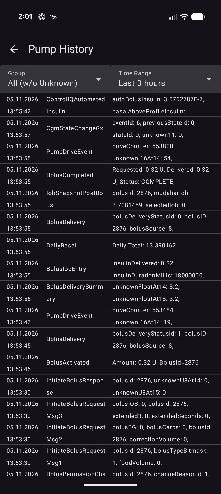

- Filter by **Group** (the default shows everything except unknown items) and by **Time Range**.
- Tap a record to see its details.

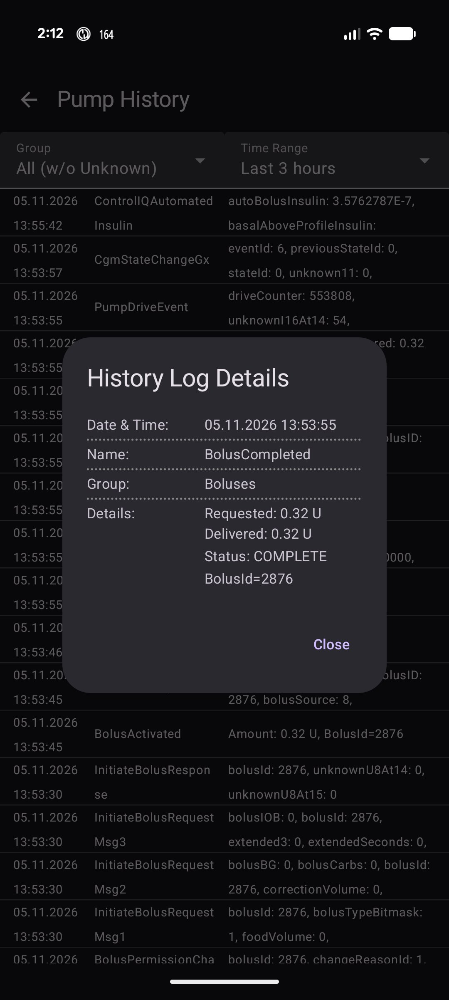

For the list of known history logs, see the [PumpX2 history log reference](https://jwoglom.github.io/pumpX2/javadoc/messages/com/jwoglom/pumpx2/pump/messages/response/historyLog/package-summary.html).

(tandem-mobi-troubleshooting)=
## Troubleshooting

### Bluetooth related issues

For known issues with Bluetooth connections and dropouts, see [Bluetooth Troubleshooting](https://androidaps.readthedocs.io/en/latest/GettingHelp/BluetoothTroubleshooting.html) in the **AAPS** documentation.

### Bluetooth errors after switching between AAPS and ControlX2

Force-stopping the app connected to the pump doesn't always release the connection. If you get a Bluetooth error when starting the other app:

1. Force-stop the app. Turn Bluetooth off, wait 10 seconds, turn it back on, and start the app again. This works most of the time.
2. If that doesn't help, restart the phone.

% VERIFY: this tip comes from the Phase 1 documentation. Confirm it still applies.

### The pump can't be found when pairing

Check the app's permissions, including Location. See [If the pump can't be found](#tandem-mobi-pump-not-found).

### The pump has powered down

If you forgot to charge the pump and it has shut down, don't panic. Charge it for about 15 minutes, then wake it from sleep mode (see [Powering on the Mobi](#tandem-mobi-power-on)). Start **AAPS** and the pump should be running. Then:

1. Confirm the notification that the pump shut down. Confirm any other [notifications](#tandem-mobi-notifications) too, because they block the next steps.
2. [Change the cartridge](#tandem-mobi-change-cartridge).
3. [Start insulin](#tandem-mobi-stop-resume).

(tandem-mobi-malfunction-codes)=
### Malfunction codes

The PumpX2 library currently shows some malfunction codes that the official Tandem Mobi app does not treat as malfunctions. The official app appears to allow-list specific codes as "real" malfunctions that require you to call Tandem. Some malfunctions disappear when you confirm the related alarm in the [Notifications](#tandem-mobi-notifications) view.

**Please don't contact Tandem about malfunction codes shown in AAPS.** If you suspect the pump hardware is faulty, switch back to the official Tandem Mobi app to check whether the malfunction is real.

### Collecting logs

If something crashes, or you are asked for logs, see [Collecting logs](../testing/testing-guide.md#collecting-logs) in the testing guide.

(tandem-mobi-where-to-get-help)=
## Where to get help

All of the development work for the Tandem Mobi driver is done by the community on a **volunteer** basis; please keep this in mind and use the following guidelines before requesting assistance:

- **Level 0:** Read the relevant section of this documentation to make sure you understand how the functionality you are having trouble with is supposed to work.
- **Level 1:** If you still have a problem you can't solve with this page, post in the **#t_mobi-test** channel on **Discord**, so we can discuss whether it is a bug or how the implementation works.
- **Level 2:** Search the [AAPS_Tandem_Testing issues](https://github.com/andyrozman/AAPS_Tandem_Testing/issues) to see whether your problem has already been reported. If it has, add your information there. If it hasn't, and it was confirmed as a bug on Discord, open a new issue with your [log files](../testing/testing-guide.md#collecting-logs).
- **Be patient:** most of our community are good-natured volunteers, and solving issues often takes time and patience from both users and developers.

When asking for help, include:
- your Android phone make and model, and Android version
- the **AAPS** version and the Mobi **Driver Version** (turn on [Display Driver Version](#tandem-mobi-settings))
- a plain description of the problem: what happened, when, and whether it worked before
