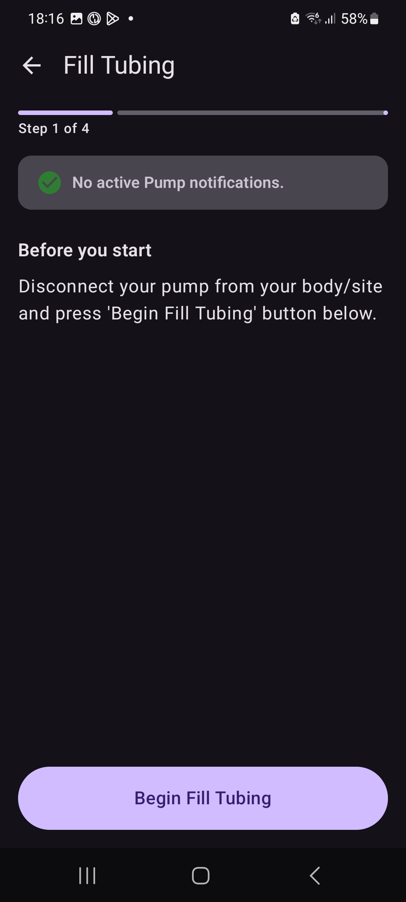

# Contributing to these docs

The documentation is built with [Sphinx](https://www.sphinx-doc.org/) from
[MyST Markdown](https://myst-parser.readthedocs.io/) files in the `docs_src` folder of the
[AAPS_Tandem_Testing repository](https://github.com/andyrozman/AAPS_Tandem_Testing). MyST
Markdown is also used by the official AndroidAPS documentation, which makes it easier to move
these pages upstream when the driver is released.

## Building locally

```bash
pip install -r docs_src/requirements.txt
sphinx-build -W --keep-going -b html docs_src _build/html
```

Open `_build/html/index.html` in a browser. For automatic rebuilds while editing, install
`sphinx-autobuild` and run `sphinx-autobuild docs_src _build/html`.

## Publishing

The same sources publish to two places:

GitHub Pages
: Every push to the `testing` branch that changes `docs_src` rebuilds and publishes the site with
  GitHub Actions (`.github/workflows/docs.yml`). Pull requests are built but not published.

Read the Docs
: Configured by `.readthedocs.yaml` at the repo root. Read the Docs rebuilds on every push to the
  branches it tracks, and can build a preview of each pull request.

Both builds fail on any Sphinx warning, so a broken link or missing image never reaches the
published site.

### Previewing on your fork

The GitHub Pages workflow publishes to whichever repo runs it, so a fork gets its own preview
site at `https://<your-user>.github.io/AAPS_Tandem_Testing/`, with "Edit on GitHub" links pointing
at the fork. To set it up, in your fork:

1. **Actions** tab: enable workflows.
2. **Settings → Pages → Build and deployment → Source:** GitHub Actions.
3. Push to `testing`, or run the **Documentation** workflow by hand from the Actions tab. To
   publish from another branch, allow it in **Settings → Environments → github-pages**.

## Layout

The pump documentation follows the layout of the pump pages in the official
[AndroidAPS documentation](https://github.com/openaps/AndroidAPSdocs/tree/master/docs/EN/CompatiblePumps)
(for example `OmnipodDASH.md` and `MedtrumNano.md`), with the same relative paths, so the page and
its images can be copied into `docs/EN/` there when the driver is released.

| Path | Contents | Upstream equivalent |
| --- | --- | --- |
| `docs_src/CompatiblePumps/TandemMobi.md` | The pump page | `docs/EN/CompatiblePumps/TandemMobi.md` |
| `docs_src/images/tandem/` | Its screenshots | `docs/EN/images/tandem/` |
| `docs_src/index.md` | Home page and table of contents | (none) |
| `docs_src/testing/`, `contributing/`, `archive/` | Pages for testers of this beta only | (none) |
| `docs_src/conf.py` | Sphinx configuration, including the driver version shown on the home page | |
| `docs_src/_static/` | Custom CSS, and a script that redirects links to the old docs | |
| `docs_src/SCREENSHOTS.md` | Screenshot inventory (not published) | |
| `docs_src/TODO.md` | The **Todo** page: screenshot checklist, open questions, steps before publishing | |
| `docs_src/tools/screenshots.py` | Capture, redact and resize screenshots | |
| `.readthedocs.yaml` | Read the Docs build configuration | |
| `.github/workflows/docs.yml` | GitHub Pages build and deploy | |

## Writing conventions

Follow the conventions of the upstream pump pages:

- Top-level sections, in order: **Pump capabilities with AAPS**, **Hardware and software
  requirements**, **Before you begin**, **Setup** (connection options A and B, then the settings),
  **Mobi Specific Architecture** (how the driver and pump work: limitations, startup, notifications,
  events, history, bolus), **Pump Screen** (fields and buttons), **Mobi Specific UI** (Actions,
  Data), **Troubleshooting**, **Where to get help**.
- Explain how something works under Mobi Specific Architecture, and how to use its screen under
  Mobi Specific UI, and link the two.
- A label before every section, prefixed with `tandem-mobi-`, for example
  `(tandem-mobi-fill-tubing)=`. Link to sections with `[text](#tandem-mobi-fill-tubing)`.
- **Bold** for app names (**AAPS**) and for buttons, screens and settings as they appear in the app.
- Notes and warnings as ```` ```{note} ```` / ```` ```{warning} ```` / ```` ```{important} ```` blocks.
- One setting per `####` heading under **Setup → Mobi settings**.

## Screenshots

Phone screenshots go in `docs_src/images/tandem/`, named `v4_<screen>.jpg` for the current
AAPS 4 UI. Always redact the pump serial number and Bluetooth address.

Insert them as plain Markdown images, the way the upstream pages do, placed under the step they
illustrate (indented by three spaces inside a numbered step):

```md
1. Tap **Fill Tubing**, then **Begin Fill Tubing**.

   
```

A screenshot from an older AAPS version gets the upstream "Older screenshot" note under it:

````md
```{admonition} Older screenshot
:class: note
The screenshot above is from an earlier **AAPS** version. ...
```
````

See `docs_src/TODO.md` for the screenshots that still need to be retaken.
